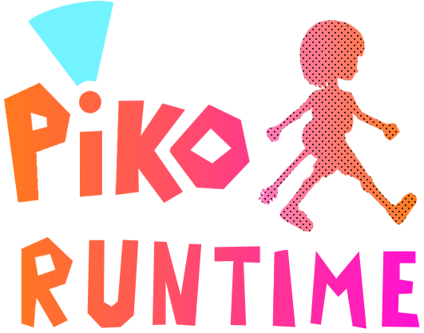

  

---

PIKO Runtime is a native reimplementation of the **Gitaroo Man** game engine, developed through reverse engineering, for **Windows (x64)**. It also supports additional content from **Gitaroo Man Lives!**.

## Goals

PIKO aims to make **Gitaroo Man** as easy and enjoyable to experience on modern PCs as possible, while adding quality-of-life improvements to help make the experience more convenient for both returning players and newcomers.

## Contributing

Contributions are of course welcome!

Please keep changes focused, follow the existing project style where possible, and explain what your changes do and why they are needed. If a change is intended to match behaviour from the original games, describe that behaviour and how you verified it.

AI-assisted code contributions are also welcome, I would just kindly ask that you manually review and verify the changes before submitting them.

## How to Play

PIKO Runtime **does not include any game data**.
To play, you must provide your own legally obtained copy of **Gitaroo Man for PlayStation 2**. For Gitaroo Man Lives! content, also provide your own legally obtained PSP ISO.

1. On first launch, select your ISO(s) when prompted.
2. Choose an audio format: **FLAC** for lossless audio, or **Opus** for smaller files.
3. Start the import and wait for it to finish.

Importing can take some time, so just let it do its thing.

A controller is recommended, but mouse and keyboard controls are also supported.

## Special Thanks!

[@sonicfind](https://github.com/sonicfind) and [@boringhexi](https://github.com/boringhexi) for the insane amount of research and documentation on the game.

[@Jakoo777](https://github.com/Jakoo777) for the cute application icon.

[BehemothArts](https://bsky.app/profile/behemotharts.bsky.social) for the wonderful logo character art.
